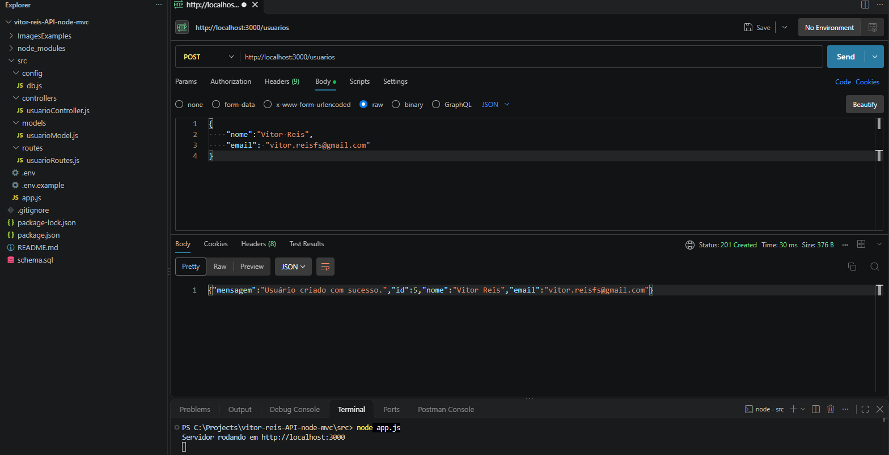
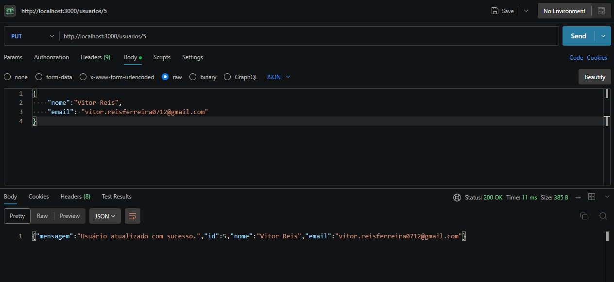
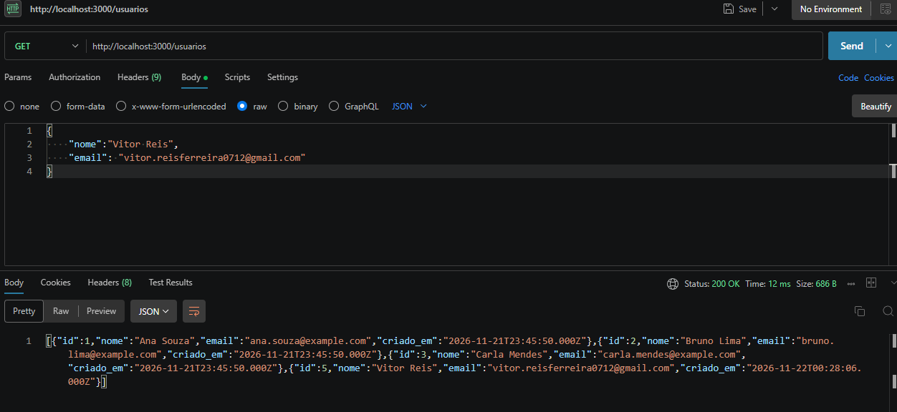
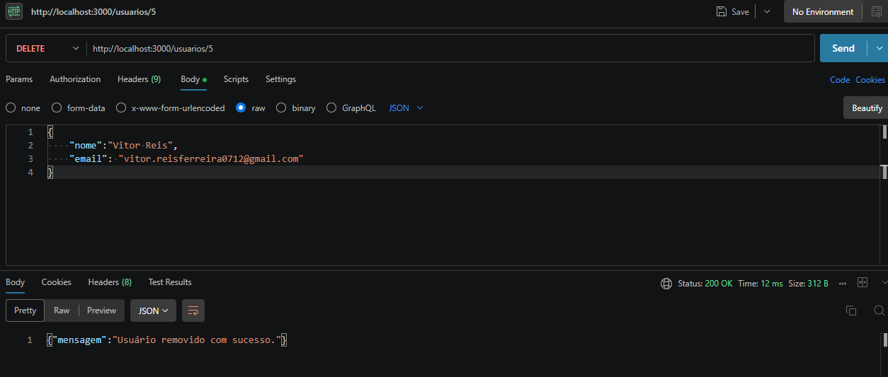

# API REST com Node.js, Express e MySQL — Arquitetura MVC

**Aluno:** Vitor Reis
**Disciplina:** Programação Web III (PW3)

Evolução da API REST da atividade anterior, refatorada para o padrão **MVC**. Usa Express e MySQL, com SQL direto via `mysql2` (Pool de conexões) com queries parametrizadas (`?`) para evitar SQL Injection.

## Tecnologias

- Node.js
- Express
- mysql2
- dotenv
- cors

## Pré-requisitos

- [Node.js](https://nodejs.org/) 18 ou superior
- [MySQL](https://dev.mysql.com/downloads/) 8 ou superior em execução

## Instalação e execução

1. Clone o repositório e entre na pasta:

   ```bash
   git clone https://github.com/VitorReis12/vitor-reis-API-node-mvc.git
   cd vitor-reis-API-node-mvc
   ```

2. Instale as dependências:

   ```bash
   npm install
   ```

3. Crie o banco e a tabela executando o script `schema.sql`:

   ```bash
   mysql -u SEU_USUARIO -p < schema.sql
   ```

   (Ou abra o arquivo no MySQL Workbench e execute.)

4. Crie o arquivo `.env` a partir do modelo e preencha com suas credenciais:

   ```bash
   cp .env.example .env
   ```

5. Inicie o servidor:

   ```bash
   npm start
   ```

   A API ficará disponível em `http://localhost:3000`.

## Rotas

| Método | Rota            | Descrição                          | Retornos            |
|--------|-----------------|------------------------------------|---------------------|
| POST   | `/usuarios`     | Cria um usuário (`nome`, `email`)  | 201, 400, 409, 500  |
| GET    | `/usuarios`     | Lista todos os usuários            | 200, 500            |
| PUT    | `/usuarios/:id` | Atualiza `nome` e `email` por ID   | 200, 400, 404, 409, 500 |
| DELETE | `/usuarios/:id` | Remove o usuário pelo ID           | 200, 404, 500       |

### Exemplos

```bash
# Criar
curl -X POST http://localhost:3000/usuarios \
  -H "Content-Type: application/json" \
  -d '{"nome":"Daniel Rocha","email":"daniel@example.com"}'

# Listar
curl http://localhost:3000/usuarios

# Atualizar
curl -X PUT http://localhost:3000/usuarios/1 \
  -H "Content-Type: application/json" \
  -d '{"nome":"Ana Souza Silva","email":"ana.silva@example.com"}'

# Remover
curl -X DELETE http://localhost:3000/usuarios/1
```

## Arquitetura em camadas (MVC)

Como a aplicação é apenas um backend, a camada **View** é representada pelas respostas JSON enviadas pelo Express. Cada pasta tem uma responsabilidade única:

| Camada | Pasta | Responsabilidade |
|--------|-------|------------------|
| Config | `src/config/` | Carrega o `.env` (dotenv) e cria o pool de conexões MySQL. |
| Model | `src/models/` | Único lugar com SQL (`SELECT`, `INSERT`, `UPDATE`, `DELETE`), sempre com queries parametrizadas. |
| Controller | `src/controllers/` | Recebe `req`, valida os dados, chama o Model e responde com o status HTTP adequado. |
| Routes | `src/routes/` | Define os endpoints com `express.Router()` e liga cada verbo ao Controller. |
| App | `src/app.js` | Configura os middlewares (`cors`, `express.json`), monta as rotas e sobe o servidor. |

Fluxo de uma requisição: `Rota → Controller → Model → MySQL`, e o retorno segue o caminho inverso até virar JSON.
Nenhum SQL aparece em `app.js` nem nas rotas.

## Estrutura

```
.
├── src/
│   ├── config/
│   │   └── db.js                  # Pool de conexão com MySQL
│   ├── models/
│   │   └── usuarioModel.js        # Consultas SQL isoladas
│   ├── controllers/
│   │   └── usuarioController.js   # Lógica de requisição/resposta
│   ├── routes/
│   │   └── usuarioRoutes.js       # Endpoints REST
│   └── app.js                     # Middlewares e subida do servidor
├── schema.sql                     # DDL + dados de exemplo
├── .env.example                   # Modelo das variáveis de ambiente
├── .gitignore
├── package.json
└── README.md
```





